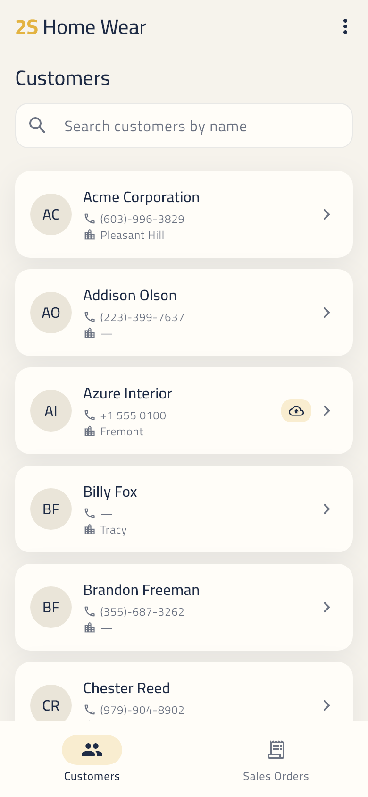
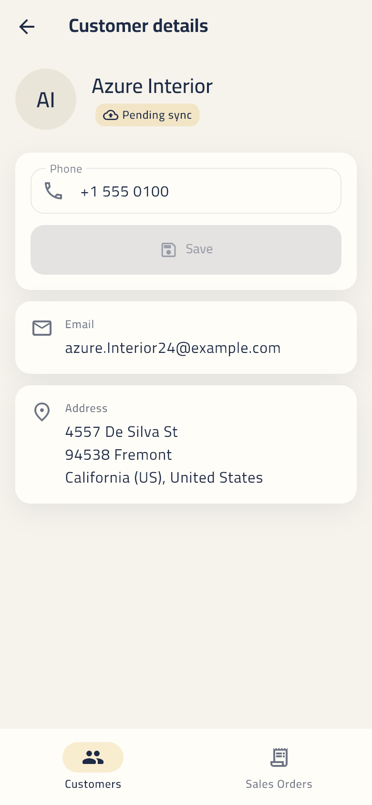
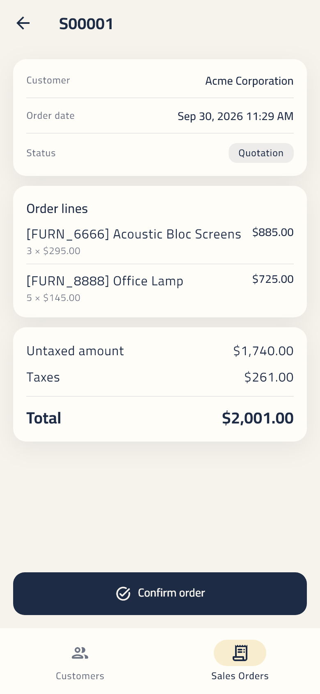
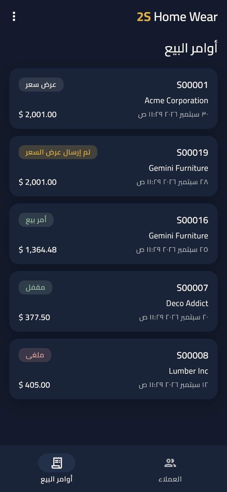
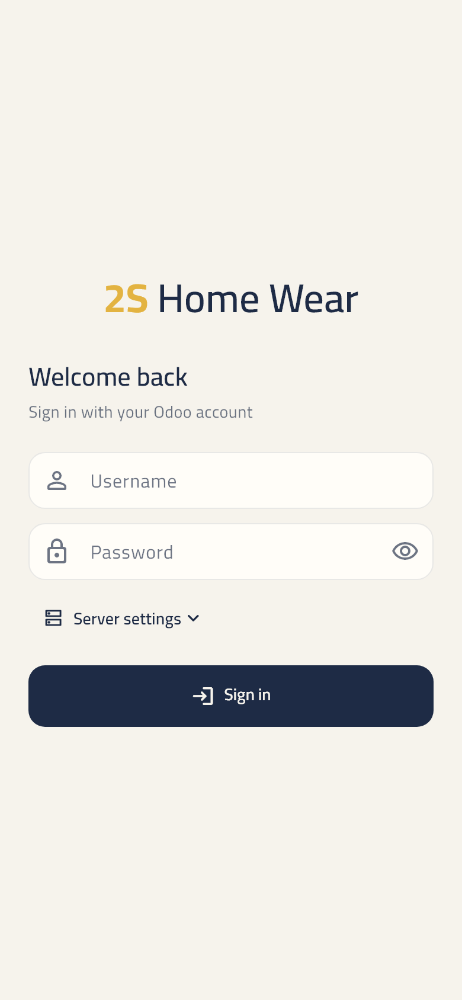
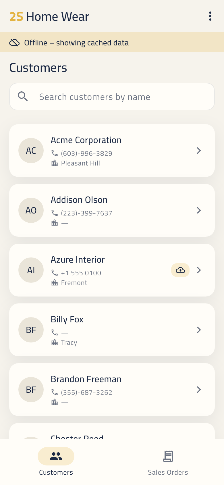
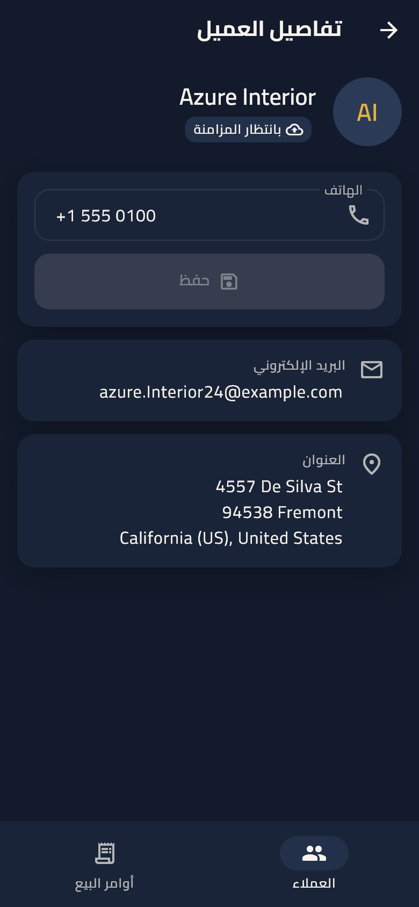
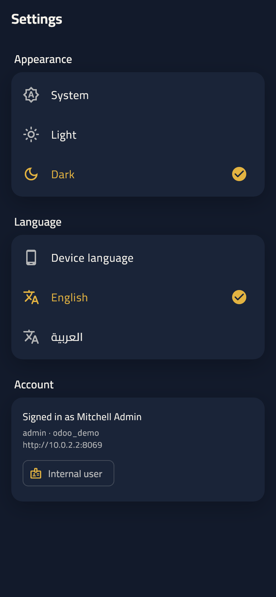
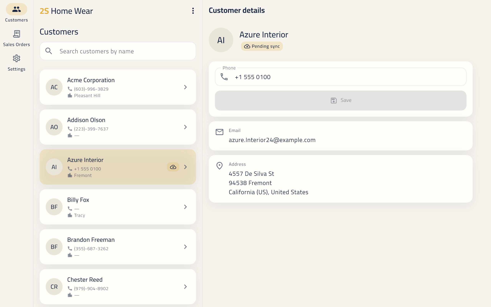
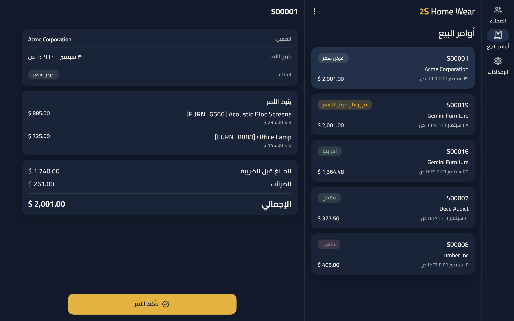

# 2S Home Wear — Odoo 17 companion app

A Flutter app for **2S Home Wear** staff to browse customers, edit phone numbers (even offline) and confirm sales quotations. It talks to a stock **Odoo 17** server.

<p>
  
  
  
  
</p>

---

## 1. Overview & feature checklist

| Feature | Status |
|---|---|
| Login (username/password + collapsible server URL / database) | ✅ |
| Clear errors: wrong credentials vs. server unreachable vs. wrong database | ✅ |
| Auto-login on start, silent re-auth on session expiry, logout clears everything | ✅ |
| Internal-user detection (`res.users.has_group('base.group_user')`) + route guard | ✅ |
| Customer list: search (400 ms debounce), infinite scroll (30/page), pull-to-refresh, loading/empty/error states | ✅ |
| Customer details: formatted address, phone edit with validation, `write` to Odoo | ✅ |
| Sales Orders (internal users only): list, details with lines + totals, colored status chips | ✅ |
| Confirm quotation (`action_confirm`) with confirmation dialog; chip animates to the new state | ✅ |
| JSON-RPC primary transport + XML-RPC fallback | ✅ |
| **Bonus: full offline mode** (cache, offline edits queue, auto-sync, pending-sync markers) | ✅ **done** |
| Material 3, brand palette, light / dark / system theme (persisted, animated) | ✅ |
| English + Arabic (full RTL), language switch (persisted), localized dates / money / statuses | ✅ |
| Responsive: phone single pane; tablet/desktop list-detail split + NavigationRail | ✅ |
| Motion: press feedback, morphing buttons, staggered lists, Hero, shimmer, fade-through / shared-axis routes, reduce-motion aware | ✅ |
| Every hand-written Dart file ≤ 100 lines (`tool/check_file_length.dart`) | ✅ |

## 2. Setup

### 2.1 Odoo (one command)

1. Install **Docker Desktop** and start it.
2. From the repo root run **one** of:

```bash
sh docker/setup_odoo.sh
```

```powershell
powershell -ExecutionPolicy Bypass -File docker\setup_odoo.ps1
```

The script is idempotent: you can re-run it at any time. It:

1. Runs `docker compose up -d` from `docker/` (Postgres 15 + Odoo 17 on `http://localhost:8069`).
2. Creates the database **`odoo_demo` with demo data** via the `db` JSON-RPC service. The master password is the image default `admin`, because `admin_passwd` is commented out in the image's `odoo.conf`.
3. Installs the **Sales** app. It installs `sale` and also `sale_management`, which provides the *Sales* menu in the web UI.
4. Makes sure `admin/admin`, `demo/demo` (internal) and `portal/portal` (portal only, `base.group_portal`) exist and can log in. It then checks `has_group` for each.
5. Marks the demo contacts as customers. Odoo 17 demo data only gives `customer_rank > 0` to 2 partners (those with posted invoices), which is too few to exercise search or pagination. After this step 32 customers exist.
6. Makes sure at least two `draft`/`sent` quotations exist so **Confirm** can be tested.

The provisioning logic lives in `docker/setup_odoo.py`. It runs *inside* the Odoo container, which ships Python 3, so the host needs nothing but Docker.

Doing it by hand instead: `cd docker && docker compose up -d`. Then open <http://localhost:8069>, create `odoo_demo` with **Demo data** checked (master password `admin`), and install **Sales** from Apps. Run the script afterwards anyway for the customer and quotation seeding.

### 2.2 Flutter

Flutter 3.38+ (Dart 3.10).

```bash
flutter pub get
```

Localizations are generated on build (`flutter: generate: true`). To regenerate them manually: `flutter gen-l10n`.

## 3. Test credentials

| Login / password | Type | Can access |
|---|---|---|
| `admin` / `admin` | Internal (administrator) | Customers (read + edit phone), Sales Orders (list, details, confirm) |
| `demo` / `demo` | Internal (salesman) | Customers, Sales Orders. Odoo shows the salesman only the orders their rules allow |
| `portal` / `portal` | **Portal** (not internal) | Customers screen only. The Sales Orders tab, rail item and routes are hidden and guarded. Odoo's record rules let a portal user see **only their own partner**, so the customer list is empty. That is expected Odoo behaviour |

## 4. Run

The server URL and database are compile-time defaults (`ODOO_URL`, `ODOO_DB`). Both can be changed on the login screen under **Server settings**.

Android emulator (the host machine is `10.0.2.2`; this is also the default):

```bash
flutter run --dart-define=ODOO_URL=http://10.0.2.2:8069 --dart-define=ODOO_DB=odoo_demo
```

iOS simulator (it shares the Mac's network):

```bash
flutter run --dart-define=ODOO_URL=http://localhost:8069 --dart-define=ODOO_DB=odoo_demo
```

Physical device on the same Wi-Fi (use your computer's LAN IP, e.g. from `ipconfig` / `ifconfig`):

```bash
flutter run --dart-define=ODOO_URL=http://192.168.1.50:8069 --dart-define=ODOO_DB=odoo_demo
```

Cleartext HTTP is enabled for local development: Android `usesCleartextTraffic="true"` + `INTERNET`, and iOS `NSAppTransportSecurity › NSAllowsArbitraryLoads`. Use HTTPS in production and remove these.

### Quality gates

```bash
flutter analyze
flutter test
dart run tool/check_file_length.dart
```

Extra suites, kept outside `test/` because they need a live server or write images:

```bash
flutter test test_live --dart-define=ODOO_URL=http://localhost:8069
flutter test test_screenshots --update-goldens
```

`test_live` runs the real production object graph against the Docker Odoo. It needs `setup_odoo` to have run first and covers:

- all three logins, plus the portal user being blocked from Sales Orders;
- wrong password vs. wrong database;
- pagination and search;
- an **offline phone edit that syncs once back online, checked by reading the partner back from Odoo**;
- **confirming a quotation, checked as `state = sale` in Odoo**;
- the XML-RPC transport.

`test_screenshots` regenerates every image in `screenshots/`: light/dark × English/Arabic × phone/tablet.

## 5. Architecture

Clean Architecture, feature-first, with **MVVM** in the presentation layer:

- **Model** = domain entities + use cases.
- **ViewModel** = one Cubit per screen (`XxxViewModel`) exposing an immutable Equatable `XxxState` with `copyWith`. ViewModels never import widgets or `BuildContext`.
- **View** = widgets only. They render state and forward user intents.

Errors travel as `Either<Failure, T>` (fpdart). Dependencies are wired with `get_it` (`core/di`). Routing uses `go_router` with redirect guards.

```
lib/
  core/
    connectivity/   ConnectivityService (connectivity_plus → Stream<bool>)
    di/             get_it registrations (core, features, view models)
    error/          Failure types + exception→Failure mapping
    l10n/           context.l10n, Failure→text, intl formatters, bidi helper
    motion/         reduce-motion aware durations
    network/        OdooClient, JsonRpcOdooClient, XmlRpcOdooClient,
                    FallbackOdooClient, OdooException, Odoo value parsing
    presentation/   ViewStatus/ActionStatus, SubscriptionBag mixin
    responsive/     WindowSize breakpoints, MasterDetailLayout
    router/         go_router config, auth guard, transitions
    storage/        CredentialsStore (flutter_secure_storage)
    sync/           PendingEdit, PendingEditQueue (Hive), SyncService
    theme/          AppColors, color schemes, AppPalette extension, text theme
    widgets/        AnimatedPressable, PrimaryButton, SkeletonList, ErrorView,
                    EmptyView, OfflineBanner, StateSwitcher, BrandWordmark…
  features/
    auth/           data (remote/local sources, repo) · domain · presentation
    customers/      data (remote, Hive cache, change bus, sync sender) · domain · presentation
    sales_orders/   data · domain · presentation
    settings/       theme + language (Hive) · presentation
    shell/          AppShell (bottom nav / rail), splash, sync snackbar
  l10n/             app_en.arb, app_ar.arb (+ generated/)
  app.dart, main.dart
```

Each feature's `presentation/` contains `viewmodels/`, `views/` and `widgets/`.

**Design system.** The only colors are navy `#1E2B45`, muted yellow `#E3B341` and off-white `#F6F3EC`, plus shades derived from them. They are defined in `core/theme/app_colors.dart`, mapped into hand-built light and dark `ColorScheme`s, and exposed through an `AppPalette` `ThemeExtension` (status chip tones, shimmer, shadows). No widget hardcodes a color or a user-facing string. The **Cairo** font is bundled in `assets/fonts/` (static weights 400–700, OFL). If `assets/images/logo.png` is added, it replaces the text wordmark automatically.

## 6. Why JSON-RPC primary, XML-RPC fallback

Odoo 17 has no REST API. Its own web client talks **JSON-RPC over HTTP**:

- `POST /web/session/authenticate`
- `POST /web/dataset/call_kw/{model}/{method}`

That makes JSON-RPC the closest thing to a REST transport, and the best one for a mobile app:

- JSON is native to Dart and Dio, and the payloads are smaller than XML.
- Server errors come back structured (`error.code`, `error.data.name`, `error.data.message`). The app can tell wrong credentials, a missing database, an expired session (code 100) and a business error apart without parsing strings.
- It uses a normal cookie session (`session_id`). The cookie is persisted with `PersistCookieJar`, and the password is not sent on every call.

**XML-RPC** (`/xmlrpc/2/common`, `/xmlrpc/2/object` → `execute_kw`) is Odoo's long-standing *external* API. It is kept as a fallback for deployments where the web routes are blocked or proxied (some hosting setups and reverse proxies only expose the API).

`FallbackOdooClient` tries JSON-RPC first. It switches to XML-RPC **for the rest of the session** only on a transport-level failure: a 404 or any response that isn't JSON-RPC. It **never** falls back on wrong credentials, network outages or Odoo business errors, because XML-RPC would not fix those. Logout resets the choice.

On session expiry, the JSON client re-authenticates silently with the credentials in secure storage and retries the call once. Note that XML-RPC answers `false` to a wrong password instead of raising a fault; the client maps that to "wrong credentials".

The RPC shapes were verified with `curl` against Odoo 17 before writing any Dart. For example, `has_group` is `@api.model` in 17: `args: ["base.group_user"]`, with no ids.

## 7. Offline & sync strategy

- **Cache.** Every customer list page and detail record fetched is stored in Hive. It is merged per partner, so a list refresh never drops cached detail fields.
- **Reading offline.** Customers come from the cache, sorted and **searched locally**, with a sliding *"Offline – showing cached data"* banner. A server that is unreachable while the device is "online" is treated the same way.
- **Editing offline.** The phone is updated in the cache immediately (optimistic), and a `PendingEdit {partnerId, field, value, createdAt}` is queued in Hive. Edits to the same partner + field **coalesce**: the key is `partnerId:field`, so only the latest value is kept. Rows with unsynced edits show a *pending sync* marker.
- **Syncing.** `SyncService` flushes the queue oldest-first:
  - when connectivity returns, on app start, and after login;
  - every 30 s while edits are pending, which covers "device online but server down".

  Successful edits are removed and failed ones stay queued. A network failure stops the flush early. A coalesced newer edit is never removed by an older in-flight one. The user sees *"X changes synced"*.
- **Conflicts: last write wins.** The queued value is written as-is, overwriting whatever the server has. A successful online save also drops any older queued value for that field, so it can't overwrite the newer one later.
- **Sales orders are online-only.** Offline, the screen shows a clear offline state and reloads automatically when the connection returns.
- **Logout** destroys the server session and clears the cookies, credentials, cache and queue. It asks for confirmation first, because unsynced edits are lost. Theme and language survive logout because they belong to the device.

## 8. Known limitations / possible improvements

- **Test coverage of the UI.** Screens are covered by widget tests and the screenshot suite (`screenshots/`), and the data layer by `test_live` against a real Odoo. There is no `integration_test` suite driving the UI on a device yet; that would be the next step for CI.
- Only the phone field is editable. The queue is generic (`field`/`value`), so more fields are straightforward to add.
- Last-write-wins can silently overwrite a concurrent server-side change. An improvement would be to compare `write_date` before flushing and surface conflicts.
- Pagination uses offset/limit, so records inserted meanwhile can shift pages. Keyset pagination on `(name, id)` would avoid this.
- Credentials (not just the session) are stored, in the platform keystore, to allow silent re-auth. API keys would be a better fit for production.
- Not built for Flutter Web: it uses `dart:io` and a file cookie jar, and Odoo would also need CORS.
- Portal users see an empty customer list because of Odoo record rules. A dedicated portal view would be a product decision.
- After a successful `action_confirm`, if the refetch fails, the screen reports an error even though the order *was* confirmed. Pull to refresh shows the real state.

## 9. Screenshots

Generated by `flutter test test_screenshots --update-goldens`. The full set is in [`screenshots/`](screenshots).

| Login | Customers (offline) | Details (Arabic, dark) | Settings |
|---|---|---|---|
|  |  |  |  |

Tablet, list-detail split view:



